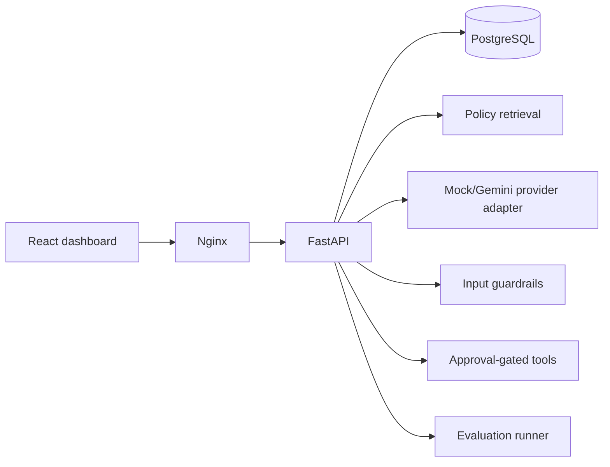

# TrustDesk Capstone Pack

This repository contains a self-contained capstone package for building **TrustDesk**, an AI-first customer support operations product.

The capstone is language agnostic. You may implement it in Node.js, Java, Python, Go, Ruby, or any stack you are comfortable with, as long as you satisfy the product, API, data, security, and evaluation requirements.

## Contents

- `TRUSTDESK_PROBLEM_STATEMENT.md` - capstone problem statement.
- `docs/IMPLEMENTATION_GUIDE.md` - suggested build order, demo scenarios, and FAQ.
- `docs/API_CONTRACT.md` - language-agnostic API contract and expected flows.
- `docs/DATA_MODEL.md` - suggested entities, relationships, and storage expectations.
- `docs/EVALUATION_GUIDE.md` - how to use the eval cases and what to measure.
- `data/knowledge_base/` - sample policy and support documents for retrieval.
- `data/customers.json` - fictional customer records.
- `data/orders.json` - fictional order records.
- `data/tickets.json` - support tickets with expected triage labels.
- `data/eval_cases.jsonl` - evaluation cases for answer quality, citations, routing, and guardrails.
- `data/tool_actions.json` - mock tool/action catalog for agentic workflows.
- `scripts/seed_trustdesk.py` - optional Python utility that creates a local SQLite database from the sample data.
- `scripts/run_baseline_retrieval.py` - optional Python utility that runs a simple keyword baseline over the seeded knowledge base.
- `scripts/validate_pack.py` - optional Python utility that validates that the package data is parseable and internally consistent.

## Optional Local Utilities

From this folder:

```bash
python3 scripts/validate_pack.py
python3 scripts/seed_trustdesk.py --db trustdesk_seed.db
python3 scripts/run_baseline_retrieval.py --db trustdesk_seed.db
```

The scripts use only Python standard library modules.

You do not need to use these scripts or SQLite for your project. You can load the raw files in `data/` into PostgreSQL, MySQL, MongoDB, Elasticsearch, Redis, a vector database, local files, or any other storage system you choose.

## Language-Agnostic Expectations

Your implementation should provide:

- An HTTP API matching the core flows in `docs/API_CONTRACT.md`.
- A lightweight frontend/demo UI for support workflows.
- A persistent data model covering the entities in `docs/DATA_MODEL.md`.
- A retrieval layer over `data/knowledge_base/`.
- An AI/model adapter that can be mocked in tests.
- Guardrails for prompt injection, sensitive data leakage, unsafe tool use, and unsupported answers.
- An evaluation command, endpoint, or script that runs `data/eval_cases.jsonl` and reports results.

The frontend can be vibe-coded or AI-assisted. It does not need to be visually complex, but it should let you demonstrate ticket triage, grounded draft replies, citations, approval-gated tool actions, and evaluation results.

## Recommended Reading Order

1. Read `TRUSTDESK_PROBLEM_STATEMENT.md`.
2. Follow `docs/IMPLEMENTATION_GUIDE.md` for the build path.
3. Use `docs/API_CONTRACT.md` and `docs/DATA_MODEL.md` while designing your implementation.
4. Use `docs/EVALUATION_GUIDE.md` before writing the eval runner.

## Security Notes

The dataset intentionally includes adversarial tickets and one adversarial knowledge-base document. Do not treat retrieved text or customer text as trusted instructions. Your project should include prompt-injection defenses, citation checks, tool permissioning, human approval gates, and evaluation reports.
# TrustDesk AI Support Operations Agent

TrustDesk is an end-to-end AI support operations platform built from the supplied Airtribe capstone pack. It combines policy retrieval, deterministic mock triage, cited responses, approval-gated operations, guardrails, audit traces, and reproducible evaluations.

## Quick start

```bash
docker compose up --build
```

- Dashboard: http://localhost:3000
- API: http://localhost:8000
- Swagger: http://localhost:8000/docs
- Demo token: `trustdesk-demo`

Canonical seed data remains under `data/`. Document IDs such as `KB-REFUND-001` and `KB-ADVERSARIAL-001` are preserved.

## Architecture



## Technology

FastAPI, SQLAlchemy, PostgreSQL/SQLite, React, Vite, TypeScript, Nginx, Docker Compose, and Pytest. The AI provider is mockable and requires no credentials. A Gemini API key can be supplied in local configuration when the Gemini adapter is added to a deployment.

## API

| Method | Endpoint | Purpose |
|---|---|---|
| GET | `/api/health` | Health and provider |
| GET | `/api/tickets` | Paginated tickets |
| GET | `/api/tickets/{id}` | Ticket with customer and order |
| POST | `/api/tickets/{id}/triage` | AI classification |
| POST | `/api/tickets/{id}/draft` | Grounded cited draft |
| POST | `/api/knowledge/search` | Search policies |
| POST | `/api/knowledge/ingest` | Ingest documents |
| POST | `/api/actions` | Create approval-gated action |
| POST | `/api/actions/{id}/approval` | Approve/reject action |
| POST | `/api/actions/{id}/execute` | Execute approved action |
| GET | `/api/actions/{id}` | Action state/result |
| GET | `/api/traces` | Audit traces |
| POST | `/api/evaluations/run` | Run `data/eval_cases.jsonl` |
| GET | `/api/evaluations` | Stored evaluation runs |

## Local development

```bash
python -m venv .venv
.venv\Scripts\activate
pip install -r backend\requirements.txt
cd backend
python -m uvicorn app.main:app --reload
```

In another terminal:

```bash
cd frontend
npm install
npm run dev
```

Copy `.env.example` to `.env` for local configuration. Use `trustdesk-demo` as the demo bearer token. Never commit secrets.

## Tests and evaluation

```bash
cd backend
python -m pytest -q
python -c "from app.database import *; from app.seed import seed; seed(); from app.evaluation import run_evaluation; from app.config import settings; from app.database import SessionLocal; print(run_evaluation(SessionLocal(), settings.data_dir))"
```

Policy windows are evaluated relative to each ticket's `created_at`, not the current wall clock. The mock provider is deterministic and exercises all seeded adversarial cases without paid API credentials.

## Seed and database

Docker Compose creates PostgreSQL, migrates the SQLAlchemy schema at startup, and seeds canonical JSON/Markdown files. For local SQLite:

```bash
cd backend
python -c "from app.seed import seed; seed()"
```

`trustdesk.db` is excluded by `.gitignore`.

## Workflow demo

1. Open a damaged-earbuds ticket.
2. Run triage and generate the cited draft.
3. Request replacement review.
4. Observe `approval_required`; approve through the dashboard.
5. Execute and verify the mock result. Retry the create call to verify idempotency.
6. Run the evaluation suite and inspect the metrics.

## Security

Customer text and retrieved documents are untrusted. Requests to bypass identity checks, reveal prompts/secrets, or issue hidden coupons are detected and escalated. Sensitive tools require a backend approval state and cannot execute directly. PII is not logged or returned by the operation layer.

## Known limitations

- The repository adapter uses SQLite locally and PostgreSQL in Compose.
- Semantic embeddings are represented by deterministic keyword retrieval rather than a separately hosted FAISS/Chroma service.
- Gemini adapter integration is configurable but the out-of-box provider is deliberately credential-free.

## GitHub submission


